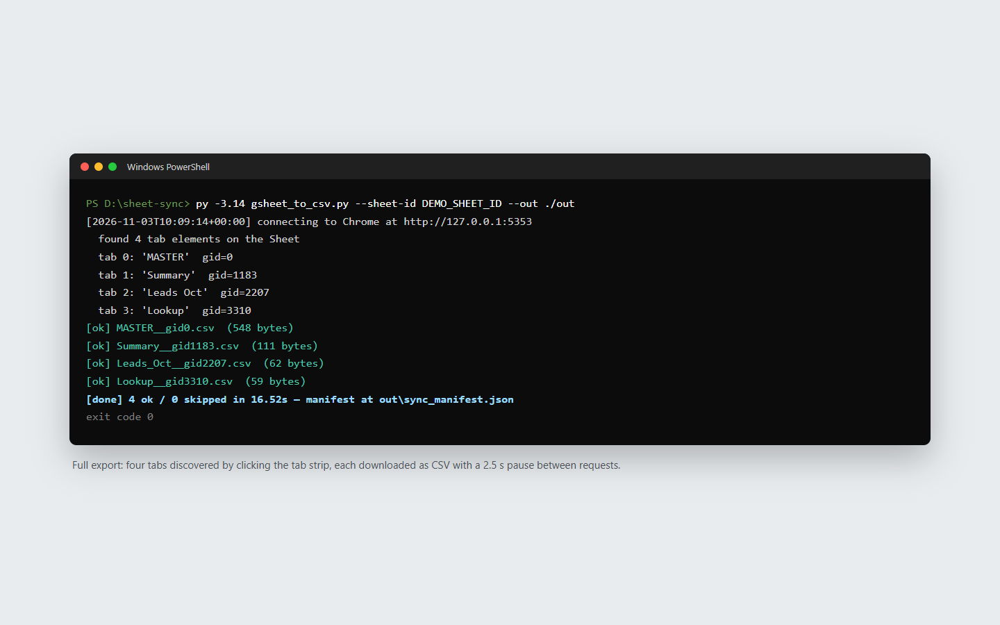
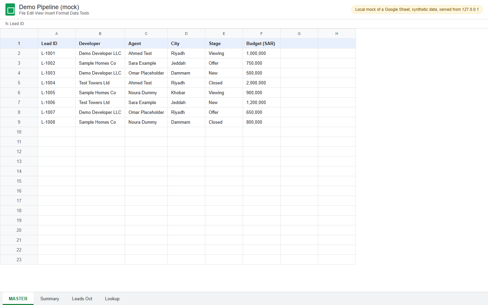
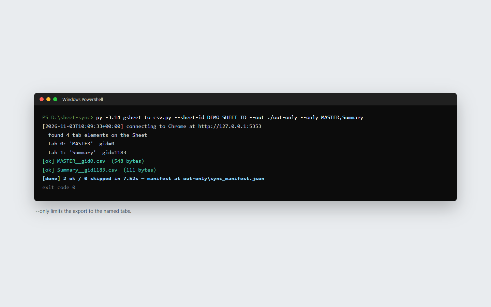
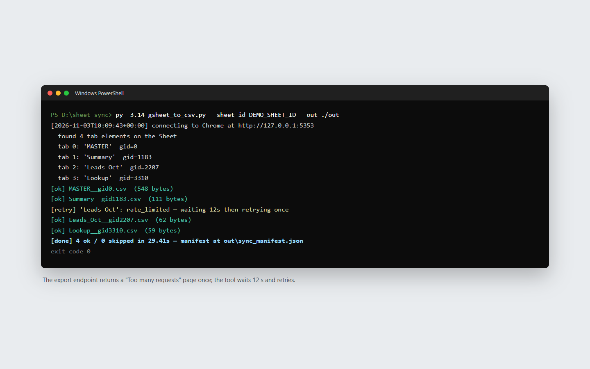
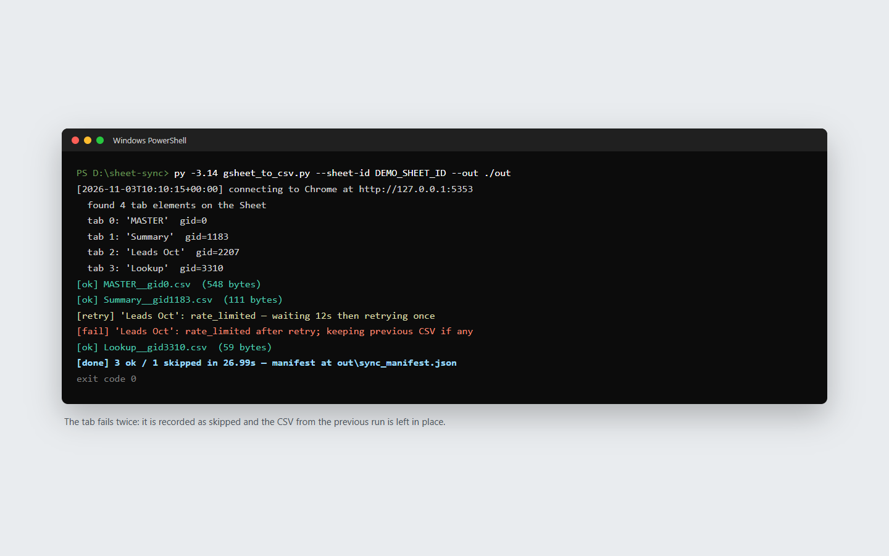
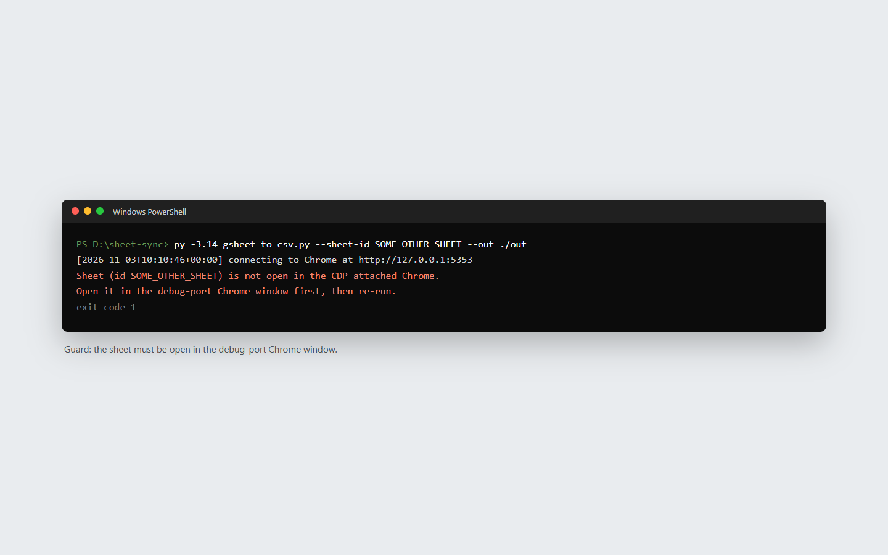
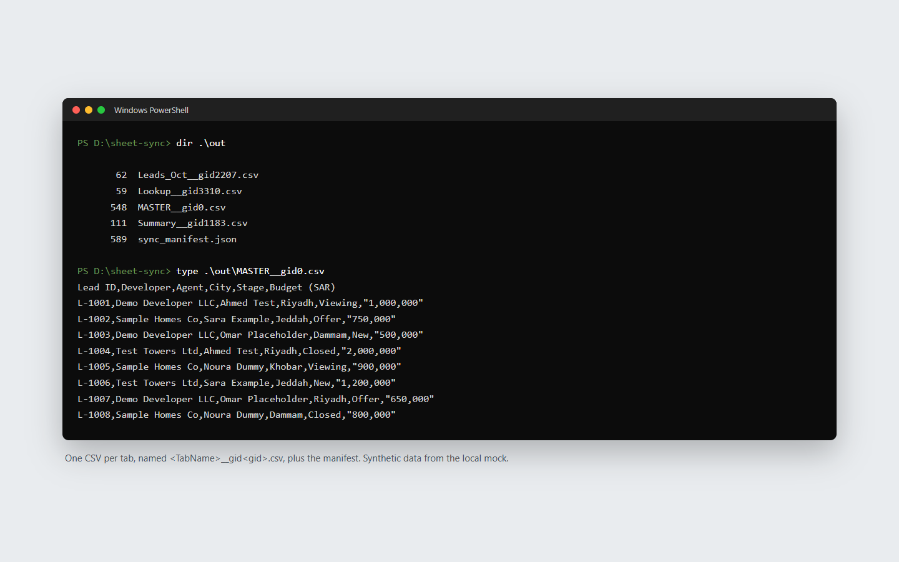
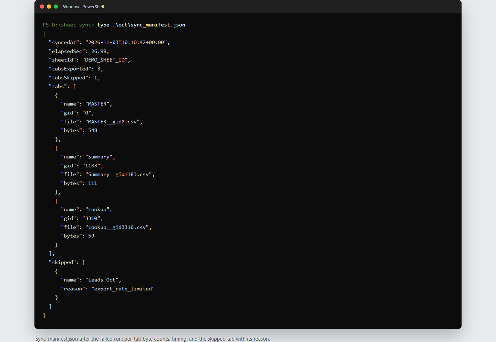

# Google Sheets to CSV sync through your own Chrome

A small command-line tool that pulls every tab of a private Google Sheet into CSV files so a
dashboard can read them. It needs no service account, API key or Google Cloud project: it drives
the Chrome window you are already signed into, so any sheet you can open in the browser, it can
export. It runs on a Windows workstation and is meant to be scheduled.

I wrote it for an internal reporting team whose dashboards read from Google Sheets, in a setup
where app-style access to Workspace was not available. I built the exporter, the Chrome launcher
and the guide that ships with them.



## What it does

**For the person refreshing a dashboard**
- Launch Chrome with one double-click, open the sheet, run one command: every readable tab
  becomes a CSV named `<TabName>__gid<gid>.csv` in the folder you choose
- Export only the tabs you need with `--only "MASTER,Summary"`
- `sync_manifest.json` records when the sync ran, how long it took and the byte count of every
  tab, plus each tab that was skipped and why (`name_unreadable`, `no_gid_in_url`,
  `click_failed`, `export_rate_limited`, `export_html_error_page`, `export_failed`)
- A clear stop with exit code 1 if the sheet is not open in the debug-port Chrome window
- Can be wrapped in a `.bat` and pointed at Windows Task Scheduler for unattended refreshes

**For the dashboard that reads the files**
- Plain CSVs in a fixed folder; the dashboard's data layer needs no change beyond the path
- A tab that fails never overwrites the previous good CSV, so a bad run cannot blank a report

## How it works

- **Attaches to your real browser.** Chrome starts with `--remote-debugging-port=9222` and a
  dedicated profile in `%USERPROFILE%\chrome-debug-profile`. Playwright connects with
  `connect_over_cdp`, so your own Google session is reused and nothing is shared with a robot
  account.
- **Finds the tabs by clicking them.** It looks through every browser context for the page whose
  URL contains the sheet ID, counts the `.docs-sheet-tab` elements, reads each tab's name, clicks
  it and takes the `gid` from the URL. Tabs that cannot be read or clicked are recorded as
  skipped, not treated as fatal.
- **Downloads through the page's own session.** Each tab is fetched from
  `export?format=csv&gid=<gid>` with the page's request context, so the private-sheet session
  carries over. A response that starts with `<!doctype` or `<html>` is treated as an error page,
  not as CSV.
- **Rate-limit aware.** 2.5 s between tabs. If the error page says "too many requests", it waits
  12 s and retries once; if that fails too, the tab is skipped and the old file stays.
- **Safe writes.** Each CSV and the manifest go to a temp file in the same folder, are `fsync`ed,
  then swapped in with `os.replace`, so a file is either the old complete version or the new one,
  never half written.

## Stack

| Layer | Choice |
|---|---|
| Language | Python 3 (developed on 3.14), standard library plus one package |
| Browser automation | Playwright for Python, attached over the Chrome DevTools Protocol |
| Browser | The installed Google Chrome with a dedicated debug profile |
| Launcher | Windows batch file (`start_chrome_debug.bat`) |
| Output | One CSV per tab plus a JSON manifest |

## Engineering

- One script of 190 lines with a single dependency (`playwright`); no browser download is needed
  because it attaches to the installed Chrome
- Every failure path (unreadable tab, click failure, missing gid, HTML error page, rate limit,
  network error) ends in the manifest's `skipped` list instead of an exception
- There are no automated tests in this repository; the behaviour shown below was checked by
  running the unmodified script against a local mock sheet

## Screenshots

| | |
|---|---|
|  |  |
| The sheet open in the debug-port Chrome (a local mock with synthetic rows) | `--only` exports just the named tabs |
|  |  |
| A "too many requests" page, a 12 s wait and a successful retry | A tab that fails twice is skipped and its previous CSV is kept |
|  |  |
| Guard when the sheet is not open in the attached Chrome | One CSV per tab, plus the manifest |
|  | |
| `sync_manifest.json` after the failed run | |

All screenshots show the real script, unchanged, running against a local mock of a Google Sheet
with synthetic data (fake developers, agents and round amounts). A small wrapper outside the
repository redirected the export URL to the mock, so no request reached Google.

## Running it locally

```
cd share\share\share
python -m venv .venv
.venv\Scripts\pip install --no-cache-dir playwright     # no "playwright install" needed
start_chrome_debug.bat                                   # close all Chrome windows first
:: sign in to Google in that window (first time only) and open the sheet
.venv\Scripts\python gsheet_to_csv.py --sheet-id <SHEET_ID> --out .\data
.venv\Scripts\python gsheet_to_csv.py --sheet-id <SHEET_ID> --only "MASTER,Summary" --out .\data
```

The sheet ID is the long string in the sheet's URL, between `/d/` and `/edit`. Use
`--cdp http://127.0.0.1:<port>` if Chrome listens on a port other than 9222. There is no `.env`:
the tool uses your browser session and stores no credentials. `README_sheet_sync.md` next to
the script has a troubleshooting table.

## Repository notes

- The working files are in `share/share/share/`: `gsheet_to_csv.py`, `start_chrome_debug.bat`
  and `README_sheet_sync.md`. `share.zip` is an earlier packaged copy of the same three files.
